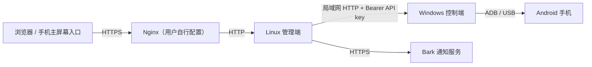

# 系统架构

## 1. 系统拓扑

系统由两个独立运行的 Python 服务组成：Windows 控制端连接手机，Linux 管理端提供网页和业务调度。两端通过 HTTP API 协作。

浏览器只访问管理端。管理端通过控制端操作手机，Bark 为可选通知服务。

## 2. 服务职责

| 服务 | 职责 | 持有的数据 |
| --- | --- | --- |
| 管理端 `manager` | 登录、设置、计划生成、任务调度、结果展示、设备监测、通知 | 配置、日期覆盖、计划、业务执行记录、派发快照、长期截图 |
| 控制端 `controller` | 设备查询、即时手机操作、执行互斥、请求去重、结果查询 | 本机配置、请求编号与实际参数、执行状态、短期完整结果及截图 |

计划和业务记录以管理端为准，手机执行状态以控制端为准。控制端只受理即时请求，业务上的再次执行由管理端根据用户操作创建。

## 3. 技术与模块

两端使用 Python、Flask、Waitress 和 SQLite。管理端使用 Jinja2 渲染页面，以进程内线程和队列处理后台任务。

| 模块 | 职责 |
| --- | --- |
| `controller/main.py` | 控制端配置、ADB 封装、请求存储、执行流程和 HTTP API |
| `manager/src/cli.py` | 管理端服务入口、进程锁、日志、代理配置及退出处理 |
| `manager/src/web.py` | 页面路由、登录、表单校验和截图访问 |
| `manager/src/planner.py` | 周规则、日期覆盖、随机计划生成及规则变更 |
| `manager/src/tasks.py` | 任务队列、执行与恢复、调度、设备监测和通知 |
| `manager/src/controller_client.py` | 控制端 API 客户端、超时、响应与截图校验 |
| `manager/src/storage.py` | 设置、计划、业务记录和派发快照的持久化 |
| `manager/templates/`、`manager/static/` | 页面模板、样式、交互脚本和桌面入口资源 |

## 4. 一次任务的数据流

1. 用户操作或计划到期，管理端在数据库中保存业务记录、请求编号、控制端连接信息和本次参数。
2. 管理端工作线程在发送前保存已发送标记，再调用控制端操作接口。
3. 控制端校验设备和参数，持久化受理记录，固定目标设备后执行手机流程。
4. 控制端保存执行状态与截图，正常情况下通过原请求同步返回结果；连接中断后，管理端按原编号查询。
5. 管理端保存结果及截图，更新关联计划，并独立发送通知。浏览器读取管理端记录展示进度和结果。

## 5. 数据归属与生命周期

| 位置 | 内容与生命周期 |
| --- | --- |
| `controller/config.json` | 本机 ADB 路径、API key、默认设备和执行参数 |
| `controller/data/requests.sqlite3` | 请求账本；完整结果默认保留 24 小时，过期后保留编号、参数绑定和终态 |
| `controller/data/screenshots/` | 与完整结果共同过期的短期截图 |
| `manager/data/checkin.sqlite3` | 配置、账号、计划、记录及任务恢复信息，长期保存 |
| `manager/data/screenshots/` | 已取得的业务截图，长期保存，不依赖控制端缓存 |

控制端数据路径可由配置指定，管理端数据路径可由启动参数指定。两端数据库各自独立，通过请求编号关联，不直接访问对方数据库。真实配置、运行数据、日志、ADB 和虚拟环境不提交 Git。

## 6. 部署与运行约束

- 控制端运行于 Windows / Python 3.12 / venv，默认监听 `0.0.0.0:8765`，管理端通过局域网访问。
- 管理端通过 Linux Docker 部署，镜像安装运行依赖，宿主 `manager/` 映射到容器 `/app`。代码更新后重启容器，依赖变化时重新构建镜像。Compose 默认发布宿主 `127.0.0.1:8000`，HTTPS 反向代理由用户自行配置。
- 每端对同一数据目录只运行一个服务实例，启动时通过文件锁防止重复运行。管理端后台任务与 Web 服务共用进程，不采用多实例调度。
- 管理端使用一个手机工作线程，调度、设备监测和通知分别运行在线程中；控制端以执行锁串行处理所有手机操作。
- 两端运行数据目录需要持久化。服务重启后依靠数据库和原请求编号恢复状态，单独删除控制端账本会丢失历史去重依据。
- 管理端通过登录、会话和 CSRF 保护业务访问；控制端通过 API key 认证。HTTPS 在 Nginx 终止，可信代理头由 Waitress 处理。

安装、启动及数据维护见[控制端说明](../controller/README.md)和[管理端说明](../manager/README.md)。实现细节分别见[控制端设计](03-controller-design.md)和[管理端设计](04-manager-design.md)。
