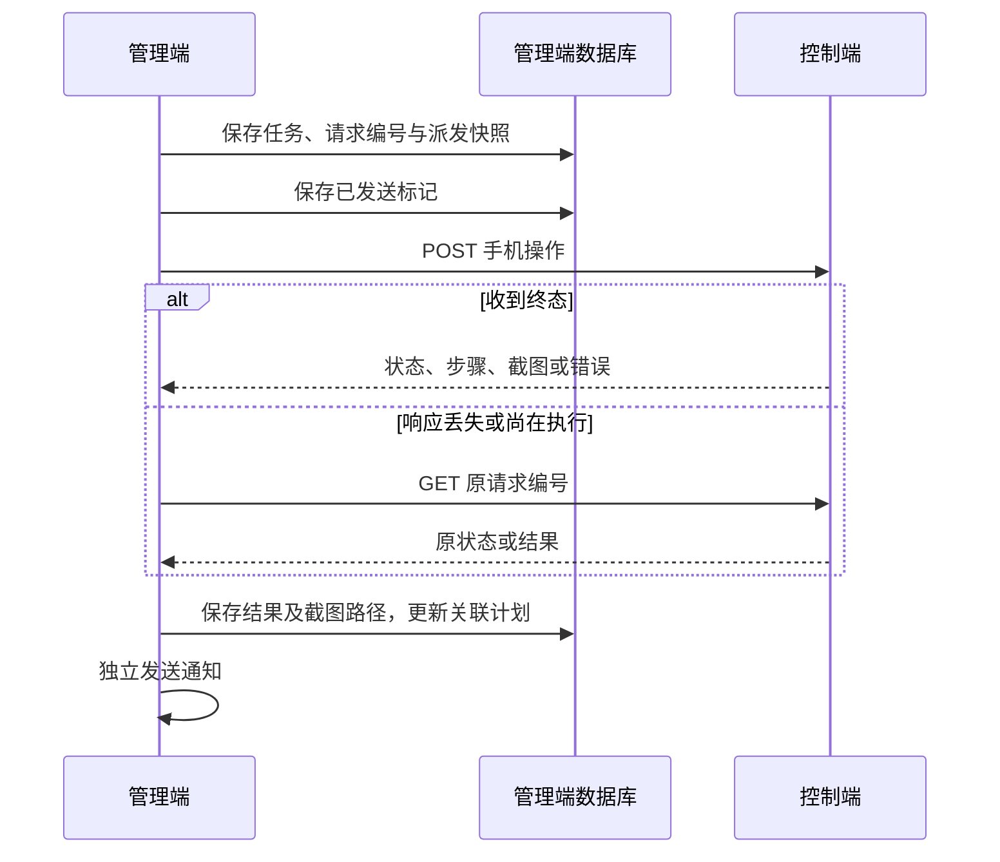

# 管理端设计

## 1. 执行模型

管理端以单进程运行，Web 请求负责页面、校验及任务入库。后台使用一个手机工作线程、一个调度线程、一个设备监测线程和一个通知线程，避免手机操作阻塞页面与监测。

手机队列使用优先级排序：恢复中的执行任务优先确认原结果，待派发手动任务优先于自动任务；同一优先级按入队顺序处理。接口及控制端执行语义见[控制端设计](03-controller-design.md)。

## 2. 配置与核心数据

| 配置 | 用途 |
| --- | --- |
| `weekdays`、`morning`、`evening` | 每周执行日及上班、下班场次的启用状态和时间窗口 |
| `paused` | 暂停自动派发 |
| `controller_url`、`controller_api_key`、`serial` | 控制端连接及可选目标设备 |
| `package`、`wait_seconds` | 可选应用包名及等待秒数，等待范围为 `0～120` |
| `bark_server`、`bark_key`、`public_url` | 通知服务、密钥及通知截图的公开地址 |

包名留空时省略 API 的 `package`；序列号留空时省略 `serial`；`wait_seconds` 始终映射为本次 `delay`。省略的参数由控制端首次受理时确定。

SQLite 使用 WAL 模式，每个操作独立建立连接，规则变更与关联计划更新通过事务完成。

| 实体 | 关键内容与关系 |
| --- | --- |
| `settings` | JSON 键值配置，包含账号、会话版本、设备状态和通知事件 |
| `day_overrides` | 日期到默认、打卡或请假模式的覆盖 |
| `plans` | 日期、场次、随机执行时刻、状态和原因；同一天同场次最多一个待执行或排队计划 |
| `runs` | 业务记录，包含唯一请求编号、触发方式、状态、步骤、时间、截图、通知结果、派发快照及控制端结果 |
| 截图文件 | 按业务日期和记录编号存入管理端截图目录，数据库保存相对路径与采集时间 |

一个自动计划最多关联一条业务记录；手动记录不关联计划。任务终态与关联计划状态在同一事务中更新。`dispatch` 保存原地址、密钥、参数和已发送标记；`remote_result` 保存控制端结果，截图 Base64 在文件落盘后从结果中移除。终态记录的派发快照清除旧 API key，快照不暴露给页面。

## 3. 计划生成与变更

### 3.1 随机时刻

日期覆盖优先于周规则：打卡启用该日已开启的场次，请假跳过，默认按周规则判断。每个有效日期、场次生成一次随机时刻并持久保存，日常补齐至未来 30 天。

```text
最早时刻 = max(窗口开始时间, 当前时间向下取整到秒 + 1 秒)
最晚时刻 = 窗口结束时间 - 等待秒数 - 30 秒
计划时刻 = 在最早时刻与最晚时刻之间按整数秒随机选择
```

窗口须处于同一天，使用时、分，且启用窗口的长度大于等待秒数加 30 秒。最早时刻超过最晚时刻时，生成错过记录。预留时间用于估算手机操作耗时，不构成手机执行完成时限。

### 3.2 规则变更

- 修改窗口、场次启用状态或等待秒数，取消受影响的待执行或排队计划，再按当前规则生成；已完成历史保留，因此可能产生当天的新计划。
- 修改周规则或日期覆盖，取消不再适用的待执行或排队计划，按变更后的规则补充适用计划。
- 暂停不重新随机计划；计划到期时记录为错过，恢复后不补跑已过去的计划。
- 重启时将已过期且尚未派发的计划记为错过；已创建的在途任务按原快照恢复。

### 3.3 派发检查

调度线程每秒检查到期计划。控制端已配置、日期与场次有效、未暂停、计划时刻未超过 5 秒且执行器与队列空闲时，创建自动任务。发送前再次检查计划有效性和是否有手动任务等待，不满足条件则记为错过。

5 秒约束管理端发送前的派发检查。已受理的手机操作继续运行，不因窗口结束或页面关闭而取消。

## 4. 任务生命周期

| 状态 | 含义 |
| --- | --- |
| `pending` | 计划已生成，尚未创建执行任务，仅用于计划 |
| `queued` | 管理端已创建任务，等待工作线程处理 |
| `running` | 工作线程正在提交请求或查询原请求结果 |
| `completed` | 控制端返回 `succeeded`，手机操作完成 |
| `failed` | 控制端已知失败，或派发前出现明确错误 |
| `missed` | 自动任务超过派发时间、忙、暂停或条件失效 |
| `cancelled` | 规则变更取消尚未执行的计划或任务 |
| `unknown` | 已发送请求的最终结果无法确认 |

手动操作使用页面生成的请求编号；同一编号重复提交返回原记录，同类手动任务仍在排队或执行时合并重复点击。自动任务创建独立编号并绑定计划。用户选择再次执行时创建新的手动记录及编号。

手动完整流程（`kind=full`）在原页面弹出确认框（手机端位于底部）：服务端从 `1～9` 生成 6 个不重复的目标数字及随机九宫格，绑定当前会话和请求编号；用户依次点选，点错清空重选，全部完成后启用“确认打卡”，服务端校验完整顺序正确才创建任务并入队，取消不执行。弹窗期间暂停页面自动刷新；沿用登录、CSRF 和请求去重机制，自动任务、截图和设备测试不进入确认流程。



## 5. 重复请求与中断恢复

任务创建时保存原控制端地址、密钥及参数，发送前提交 `sent=true`。修改连接或应用设置只影响新任务，在途任务继续使用原快照。

| 情况 | 处理策略 |
| --- | --- |
| 快照尚未标记发送 | 手动任务正常提交，自动任务重新检查派发条件 |
| 已发送后重启、网络中断或响应不可信 | 按原编号查询原控制端，不自动重新 POST |
| `accepted`、`running` | 每轮等待 2 秒后继续查询 |
| POST 明确返回 `409 DEVICE_BUSY` | 自动任务记为错过；手动任务等待后使用原编号及参数再次提交 |
| 查询 `404` | 继续确认，约 60 秒仍无记录时记为未知，不自动重新提交 |
| 查询 `410` | 保留可得的原终态和参数，注明完整结果与截图已过期 |
| 终态 `succeeded`、`failed`、`unknown` | 分别映射为完成、失败、未知，保存结果并结束任务 |
| 查询持续不可达 | 保留任务并等待网络恢复，继续查询 |

这里的 `DEVICE_BUSY` 表示请求明确未被受理，手动任务可以再次提交；结果不确定时只查询原请求。停止管理端不会取消控制端已受理的操作，重新启动后继续确认原结果。

客户端保留非 2xx JSON 中的结果和错误。默认连接超时 5 秒、GET 读取超时 15 秒，手机操作读取超时为 360 秒加本次 `delay`；控制端增加单命令超时时，客户端读取超时也需相应调整。

## 6. 结果、截图与通知

控制端返回的步骤、主错误及收尾错误保存到业务记录；已有 PNG 截图经 Base64、大小和格式校验后原子保存。截图保存失败时记录原因，保留控制端执行状态。常规截图访问经管理端登录鉴权，不暴露本机路径。

设备监测在线程中查询控制端健康状态与设备列表，每轮完成后等待约 5 秒，配置变化时可唤醒刷新。分别记录控制端连接状态、手机状态及检查时间；状态变化生成通知，持续相同状态不重复发送。

通知线程独立发送执行结果、连接状态变化及测试消息，单独保存等待、发送中、成功、失败或未配置等状态。重发通知使用原记录，不重新操作手机。发送中断后允许人工重发；配置 `public_url` 时，有截图的记录通过 `image` 参数附带图片地址，通知不发送 `url` 跳转参数。未配置公开地址或没有截图时仅发送文字，连接状态及测试消息不附图。

通知图片通过 `/bark/screenshots/<token>.png` 下载：以管理端持久化密钥和独立盐签署记录编号及时间戳，24 小时有效，重发通知时刷新。仅此接口允许凭有效签名免登录读取单条记录的截图；篡改、过期、记录或文件不存在均返回 `404`，响应禁止缓存。常规截图和详情地址仍要求登录。

## 7. 页面与认证

页面包含概览、计划日历与日期覆盖、执行记录与详情、设置。设置划分为自动计划、应用、设备、通知和账号；记录按日期筛选并分页，详情展示本次执行步骤、截图及通知结果。

使用服务端密码哈希与签名 Cookie 会话，登录有效期为 365 天并随有效访问续期。修改密码更新会话版本，使其他会话失效，当前会话继续有效。表单校验 CSRF，控制端及 Bark 密钥不回显，空值保存保持原密钥。

HTTPS 反代部署默认使用 Secure Cookie，由 Waitress 处理配置的可信代理头。直接通过 HTTP 使用时由启动参数显式关闭 Secure Cookie。安装、启动和数据维护见[管理端说明](../manager/README.md)。
